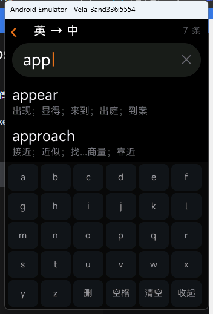
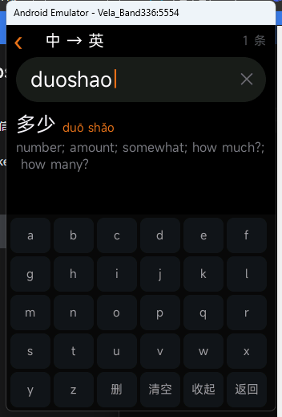
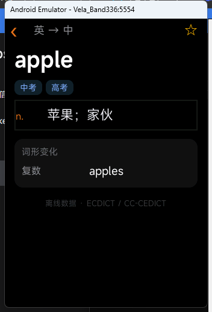
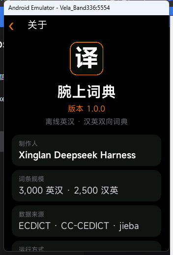

# 腕上词典 · WristDict

一个为 **小米手环 10 Pro**（Xiaomi Vela 快应用）写的**完全离线**英汉 / 汉英双向词典。

不联网、不申请麦克风、不依赖手机，打开就能查。


| 英 → 中 | 中 → 英 | 词条详情 | 关于 |
|---|---|---|---|
|  |  |  |  |

## 功能

- **英 → 中**：输入英文，前缀匹配，显示词性分组释义、考试标签（中考 / 高考 / 四六级 / 考研 / 托福 / 雅思 / GRE）、词形变化（过去式、复数、比较级…）。
- **中 → 英**：输入拼音全拼或首字母（`nihao` / `nh`），候选按词长排序，显示带声调的拼音与英文释义。
- **自绘键盘**：26 键 ABC 网格，不依赖系统输入法——手环上通常没有可用的 IME。
- **最近查询 / 收藏**：本地存储，换页不丢。
- **词条规模**：3,000 英汉 + 2,500 汉英，rpk 约 270 KB。

## 环境要求

- Node.js ≥ 18
- pnpm（或 npm）
- Windows / macOS / Linux 均可打包，模拟器仅 Windows/macOS/Ubuntu 桌面版

## 快速开始

```bash
pnpm install
pnpm build      # 开发模式，产物 dist/*.debug.rpk
pnpm release    # 生产模式，产物 dist/*.release.rpk（需要 sign/ 证书）
```

> **Windows 提示**：如果 `pnpm install` 后 `node_modules` 里的依赖解析不了（`Cannot find module '@aiot-toolkit/shared-utils'`），
> 在项目根目录建一个 `.npmrc`，写入 `node-linker=hoisted`，然后重新 `pnpm install`。

### 生成签名证书

`release` 需要 `sign/private.pem` 与 `sign/certificate.pem`：

```bash
openssl req -newkey rsa:2048 -nodes -keyout sign/private.pem -x509 -days 3650 -out sign/certificate.pem
```

**不要把自己的私钥提交到仓库**（`.gitignore` 已忽略 `sign/`）。

## 浏览器预览

`preview/` 里是一份和手环端同布局的网页版，**直接双击 `preview/index.html` 就能用**（数据以 `<script>` 加载，`file://` 下可运行）。

也可以起个静态服务：

```bash
node tools/serve-preview.mjs     # http://127.0.0.1:4180
```

## 在模拟器里跑

推荐用官方的 **AIoT-IDE**（自带模拟器管理与调试面板）：<https://iot.mi.com/vela/quickapp/zh/guide/start/use-ide.html>

命令行方式：

```bash
npx aiot start        # 构建 + 安装 + 启动到模拟器
```

> ⚠️ 已知问题：`aiot createVVD` 在 aiot-toolkit 2.0.5 上会报 `VVD directory for ... not found`。
> 仓库里的 `tools/make-vvd.cjs` 直接调用 `VvdManager.createVvd` 绕过它，创建一台 336×480 的手环虚拟机。
> 需要先 `npx aiot initEmulatorEnv` 下载模拟器与系统镜像（约 750 MB）。

## 安装到真机

1. 手机安装**小米运动健康**，连上手环；
2. 「我的 → 关于 → Debug → 第三方应用」；
3. 输入包名 `com.band.wristdict`，选择 `Install third app`，选中 `release/*.rpk`。

> 三方 Vela 应用的真机安装 / 上架目前需要与小米对接开发者资质，详见
> [Vela 常见问题](https://iot.mi.com/vela/quickapp/zh/guide/other/faq.html)。
> 没有 Debug 入口时，可以先用模拟器或 `preview/` 验证功能。

## 目录结构

```
src/
├── app.ux                  应用入口
├── manifest.json           包名、路由、designWidth 336
├── common/
│   ├── dict-en.js          英汉数据（生成物，扁平字符串）
│   ├── dict-zh.js          汉英数据（生成物）
│   ├── search.js           分桶检索
│   ├── store.js            最近查询 / 收藏 / 当前词条
│   └── logo.png
└── pages/
    ├── index/              首页
    ├── en/                 英 → 中
    ├── zh/                 中 → 英
    ├── detail/             词条详情
    ├── list/               收藏 / 最近查询
    └── about/              关于
preview/                    浏览器预览
tools/                      数据生成、预览服务、模拟器虚拟机创建
docs/                       截图
release/                    已打包的 rpk
```

## 实现要点（踩过的坑）

Vela 快应用的运行时限制比想象中多，这个项目里有几处是被真机/模拟器打回来重做的：

1. **`package.json` 不能带 `"type": "module"`**。
   否则打包器会把共享 `.js` 模块编译成 CommonJS（引用 `exports`），而 Vela 运行时没有这个全局变量，
   页面会在 `onInit` 直接抛 `ReferenceError`，表现是**纯黑屏**。
2. **单个页面的 JS 模块别超过约 0.5 MB**。
   实测 0.48 MB 可以，0.89 MB 直接黑屏（模拟器与真机都会挂）。
   所以词典没有整体 `JSON.parse`，而是**每个词一条扁平字符串**，命中时才解析那一条。
3. **`div` 默认 `flex-direction: row`**。
   列表容器（`scroll`）、详情页各个区块都要显式写 `column`，否则多条结果会横向排开、文字重叠。
4. **路由传参不可靠**。
   `router.push({ params })` 在部分固件上写不进页面，详情页改为「先写 storage，再读」。
5. **页面数据模型**：路由传参的页面用 `public`，本地状态用 `data`，两者不能同时出现。

## 重新生成词库（可选）

仓库里已包含生成好的 `dict-en.js` / `dict-zh.js`，一般不用重跑。要换词表时：

```bash
# 依赖原始语料：ECDICT、CC-CEDICT、jieba 词典，放到 ../.dict-data
node tools/download.mjs
EN_LIMIT=3000 ZH_LIMIT=2500 node tools/build-data.mjs
```

产物会写到 `src/common/` 与 `preview/data/`。

## 已知限制

- 词库是精简版，生僻词查不到；没有例句、发音。
- 拼音检索不做多音字纠错：`银行` 用 `yinhang` 能查到，输 `yinxing` 查不到。
- 结果列表最多 40 条，没有分页。
- 只在小米手环 10 Pro（336×480）与同尺寸模拟器上验证过。

## 数据来源与许可

代码以 **MIT** 发布（见 [LICENSE](LICENSE)）。

词典数据是衍生作品，遵循上游许可，详见 [NOTICE.md](NOTICE.md)：

| 数据 | 来源 | 许可 |
|---|---|---|
| 英汉词条、词频、词形 | [ECDICT](https://github.com/skywind3000/ECDICT) | MIT |
| 汉英词条、拼音 | [CC-CEDICT](https://www.mdbg.net/chinese/dictionary?page=cedict) | CC BY-SA 4.0 |
| 中文词频 | [jieba](https://github.com/fxsjy/jieba) | MIT |

因此 `src/common/dict-zh.js`、`src/common/dict-en.js` 及其预览副本按 **CC BY-SA 4.0** 分发。

---

## English

WristDict is an offline English–Chinese / Chinese–English dictionary built as a **Xiaomi Vela quick app** for the Smart Band 10 Pro (336×480).

- 3,000 EN→ZH entries and 2,500 ZH→EN entries, fully offline (~270 KB package).
- Custom on-screen keyboard (no system IME required).
- `preview/index.html` is a browser demo sharing the same layout and data.
- Build with `pnpm build` / `pnpm release` (aiot-toolkit); install via the Mi Fitness debug menu.

Code is MIT-licensed; dictionary data is CC BY-SA 4.0 (derived from CC-CEDICT) — see [NOTICE.md](NOTICE.md).
